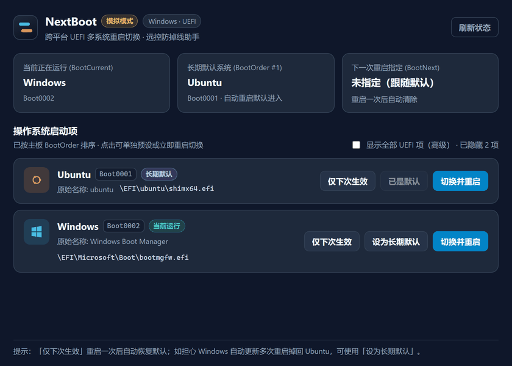
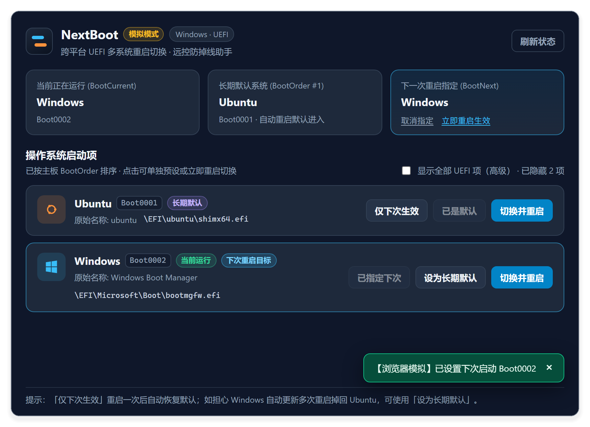
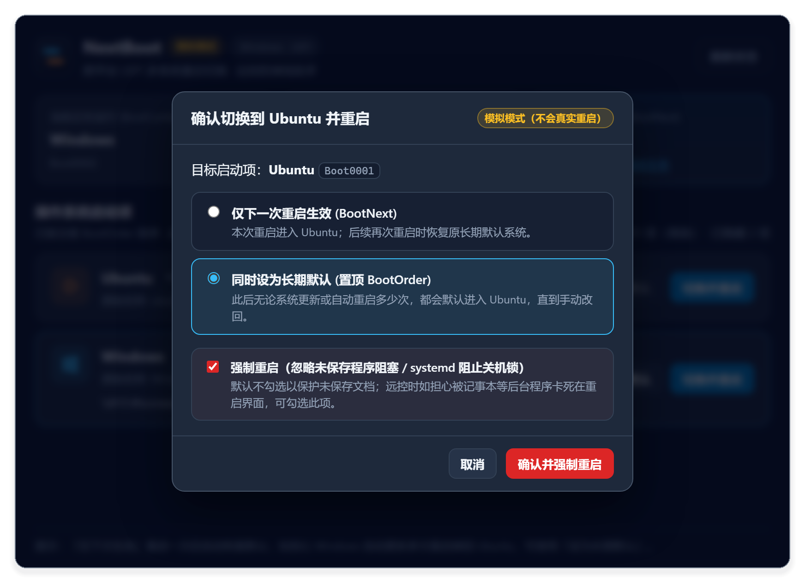
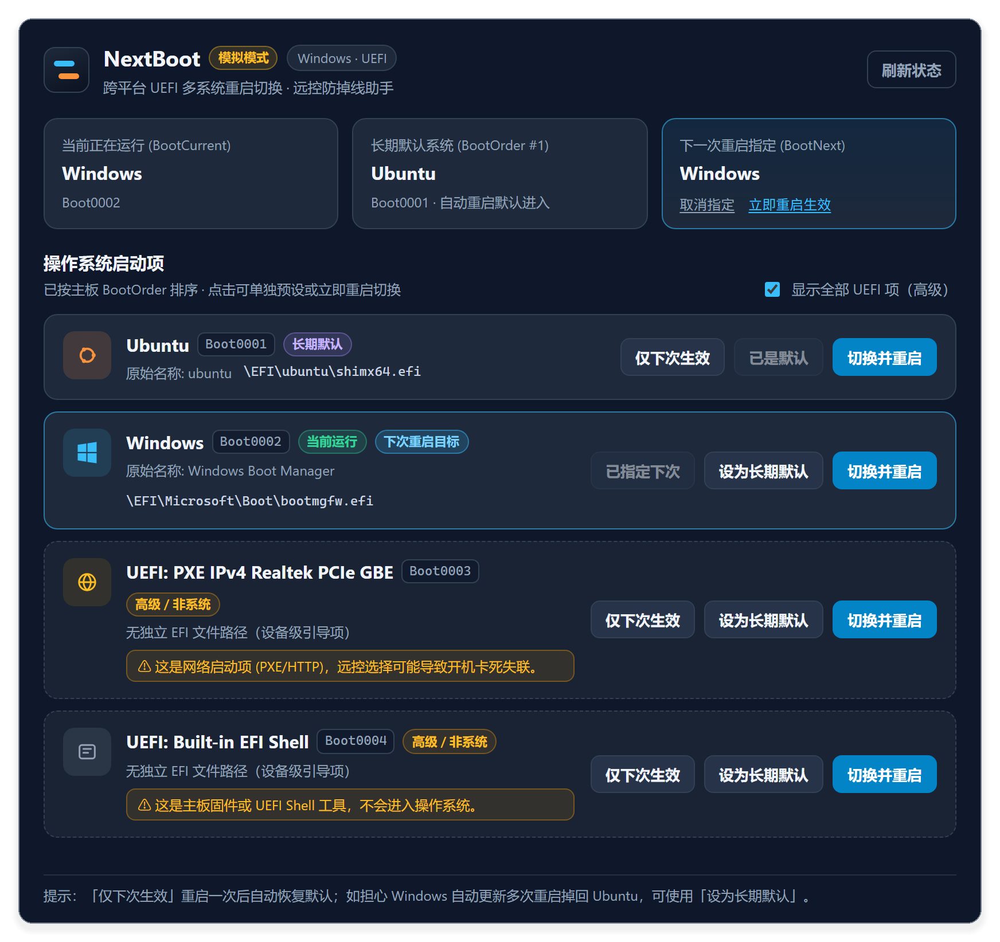
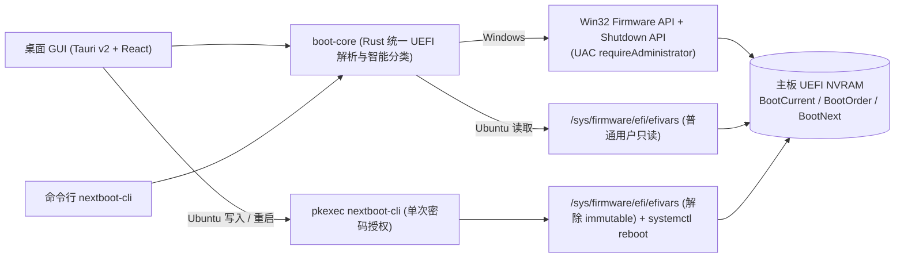

<div align="center">
  

  <br /><br />

  [](https://github.com/zhengbaiyang/nextboot/releases/latest)
  [](https://github.com/zhengbaiyang/nextboot/actions)
  [](#下载与安装)
  [](#工作原理与架构)
  [](LICENSE)

  <p>
    <strong>在系统内直接决定下一次重启进入 Windows 还是 Ubuntu，告别远控重启失联。</strong>
  </p>

  <p>
    <a href="#界面演示">界面演示</a> ·
    <a href="#为什么需要-nextboot">核心痛点</a> ·
    <a href="#下载与安装">下载安装</a> ·
    <a href="#命令行cli用法">CLI 用法</a> ·
    <a href="#工作原理与架构">工作原理</a> ·
    <a href="#本地开发与构建">开发构建</a>
  </p>
</div>

---

## 界面演示

### 动态交互预览

> 展示从查看当前系统与默认引导、一键指定 `BootNext`、展开高级 UEFI 风险项，到弹出二次确认框并切换长期默认与强制重启的完整流程：

<div align="center">
  
</div>

### 功能界面截图

<table>
  <tr>
    <td align="center" width="50%">
      
      <br />
      <strong>① 状态概览与一键切换</strong>
      <br />
      <sub>清晰展示当前运行、长期默认与下次重启指定，支持仅预设或立即重启</sub>
    </td>
    <td align="center" width="50%">
      
      <br />
      <strong>② 二次确认与远控防卡死保护</strong>
      <br />
      <sub>可自由选择「仅下次生效」或「设为长期默认」，支持勾选「强制重启」</sub>
    </td>
  </tr>
  <tr>
    <td align="center" colspan="2">
      
      <br />
      <strong>③ 智能过滤杂项与高级模式风险提示</strong>
      <br />
      <sub>默认隐藏网卡 PXE、U 盘与 UEFI Shell；开启高级模式后高亮提醒风险项，防止远控误选失联</sub>
    </td>
  </tr>
</table>

---

## 为什么需要 NextBoot？

当你的工作电脑安装了 **Ubuntu + Windows 双系统** 且主引导默认是 Ubuntu，又经常通过 **RustDesk / ToDesk / 向日葵 / RDP / SSH** 远程操作时：

| 常见痛点 | NextBoot 的解决方案 |
| :--- | :--- |
| 远控重启时无法在主板 / GRUB 启动菜单按键选系统 | 在当前系统内直接指定下一次重启进入目标系统（写入 UEFI `BootNext`） |
| 切到 Windows 后，系统更新或意外重启又自动掉回 Ubuntu | 支持一键「**设为长期默认**」（置顶 UEFI `BootOrder`），多次重启仍稳稳进 Windows |
| 远控点击重启时，Windows 被未保存的记事本/后台程序卡在关机界面 | 重启确认框内置「**强制重启**」选项（Windows 强制关闭阻塞程序 / Ubuntu 忽略 systemd 抑制锁） |
| 跨系统修改对方磁盘分区的 GRUB 配置容易出错甚至损坏文件系统 | 直接读写主板 **UEFI NVRAM**，Windows 与 Ubuntu 互不触碰对方磁盘，零侵入 |
| 主板 UEFI 列表混杂 PXE 网卡、U 盘、EFI Shell，误点会导致远程失联 | 智能解析 UEFI Device Path，默认仅展示操作系统项，并对非系统项给出醒目警告 |
| 后台常驻服务占资源，或 Ubuntu Wayland 下无法直接用 root 启动 GUI | **按需打开、用完即关**：Windows 嵌入 UAC 清单；Ubuntu GUI 普通用户运行，仅写入/重启时 `pkexec` 单次授权 |

---

## 下载与安装

前往 [**GitHub Releases 页面**](https://github.com/zhengbaiyang/nextboot/releases/latest) 直接下载对应平台安装包：

| 目标系统 | 推荐下载文件 | 说明 |
| :--- | :--- | :--- |
| **Windows 10 / 11 (桌面版)** | `NextBoot_*_x64-setup.exe` 或 `*.msi` | 正式安装包，打开自动请求一次 UAC 管理员权限 |
| **Windows 10 / 11 (免安装绿色版)** | `NextBoot-portable-windows-x64.exe` | 单文件双击即用，无需安装 |
| **Windows 10 / 11 (命令行版)** | `nextboot-cli.exe` | 适合脚本调用，请在管理员终端运行 |
| **Ubuntu 22.04 / 24.04 (桌面+CLI)** | `NextBoot_*_amd64.deb` | 执行 `sudo apt install ./NextBoot_*_amd64.deb`，同时安装桌面图标与 `/usr/bin/nextboot-cli` |
| **Linux (独立命令行版)** | `nextboot-cli-linux-x64` | `chmod +x` 后配合 `sudo` 运行，适合无桌面 SSH 场景 |

> **前提要求**：目标电脑需工作在 **UEFI 引导模式**。NextBoot 启动时会自动检测固件环境，若为传统 Legacy BIOS (MBR) 会给出明确提示。

---

## 命令行（CLI）用法

除了桌面图形界面，NextBoot 还内置同源命令行工具 `nextboot-cli`，方便在 Ubuntu SSH 终端或 Windows 管理员终端中快速切换：

```bash
# 查看当前运行系统、长期默认与下次指定状态
nextboot-cli status

# 列出启动项（默认智能过滤 PXE/U盘/固件；加 --all 查看主板全部 UEFI 项）
nextboot-cli list
nextboot-cli list --all

# 设置「仅下一次重启」进入 Windows（支持编号 0002 或关键词 windows / ubuntu）
sudo nextboot-cli next windows

# 设置下次重启进入 Windows 并立即重启（加 --force 忽略未保存程序/阻止关机锁）
sudo nextboot-cli next windows --reboot
sudo nextboot-cli next windows --reboot --force

# 取消已设置的下次重启指定 (BootNext)，恢复按默认顺序启动
sudo nextboot-cli clear-next

# 将 Windows 设为「长期默认启动项」（置顶 BootOrder，防多次自动重启掉回 Ubuntu）
sudo nextboot-cli default windows
sudo nextboot-cli default windows --reboot

# 安全体验：所有命令均支持 --mock（模拟 UEFI 数据，不改主板、不真重启）与 --json 输出
nextboot-cli --mock status
nextboot-cli --mock list --json
```

---

## 工作原理与架构

NextBoot 在 Windows 与 Ubuntu 两端共享同一套纯 Rust 编写的 UEFI `EFI_LOAD_OPTION` 二进制解析与分类引擎（`boot-core`）：



### 工程目录结构

```text
.
├── crates/
│   ├── boot-core/          # 跨平台 UEFI NVRAM 解析/写入、OS 智能分类、重启控制、Mock 引擎
│   └── boot-cli/           # 独立命令行工具 nextboot-cli（兼任 Ubuntu GUI 的 pkexec 提权执行器）
├── src-tauri/              # Tauri v2 桌面宿主（Windows UAC 清单、Linux pkexec 桥接）
├── src/                    # React + TypeScript + Vite 桌面前端界面
├── docs/images/            # README 与 Release 展示用 UI 演示动图及截图
└── .github/workflows/      # GitHub Actions 双端自动测试、打包与 Release 发布工作流
```

---

## 本地开发与构建

<details>
<summary><strong>点击展开：环境依赖、模拟调试与双端打包命令</strong></summary>

### 1. 环境准备
- **Rust**（1.80+，stable 工具链）
- **Node.js**（20+）与 `npm`
- **Ubuntu 22.04 / 24.04 系统构建依赖**：
  ```bash
  sudo apt-get update
  sudo apt-get install -y libwebkit2gtk-4.1-dev libappindicator3-dev librsvg2-dev patchelf libssl-dev build-essential
  ```

### 2. 单元测试与模拟模式调试（不改动本机 UEFI）
```bash
# 运行核心库与 CLI 单元测试
cargo test -p boot-core -p boot-cli

# 模拟模式测试 CLI
cargo run -p boot-cli -- --mock list
cargo run -p boot-cli -- --mock next windows
cargo run -p boot-cli -- --mock status

# 安装前端依赖并启动模拟模式桌面开发窗口
npm install
NEXTBOOT_MOCK=1 npm run tauri dev
# Windows PowerShell:
# $env:NEXTBOOT_MOCK="1"; npm run tauri dev
```

### 3. 本地正式打包
```bash
# 1. 先构建 Release 版 CLI（Linux 打 .deb 时会自动将 nextboot-cli 打包到 /usr/bin/nextboot-cli）
cargo build --release -p boot-cli

# 2. 打包桌面端与安装程序（Windows 产出 .exe/.msi，Ubuntu 产出 .deb）
npm run tauri build
```

</details>

<details>
<summary><strong>点击展开：常见问题排查 (FAQ)</strong></summary>

1. **提示当前电脑不是 UEFI 引导模式**
   - Windows 下按 `Win + R` 输入 `msinfo32`，查看「BIOS 模式」是否为 `UEFI`；
   - Ubuntu 下检查 `/sys/firmware/efi/efivars` 目录是否存在。
   - NextBoot v1 专注 UEFI NVRAM 方案，暂不支持传统 Legacy BIOS (MBR)。
2. **Ubuntu 下源码运行 GUI 点击切换提示找不到 `nextboot-cli`**
   - 通过官方 `.deb` 安装时会自动安装 `/usr/bin/nextboot-cli`；
   - 本地开发调试时请先执行 `cargo build -p boot-cli`，确保 `nextboot-cli` 与主程序位于同一输出目录或已加入 `PATH`。
3. **如何安全验证本机主板是否支持修改 UEFI NVRAM**
   - 在 Ubuntu 下执行 `sudo nextboot-cli next <id>` 后运行 `nextboot-cli status` 查看「下次指定」是否生效，验证完成后执行 `sudo nextboot-cli clear-next` 复原即可。

</details>

---

## License

本项目基于 [MIT License](LICENSE) 开源。
