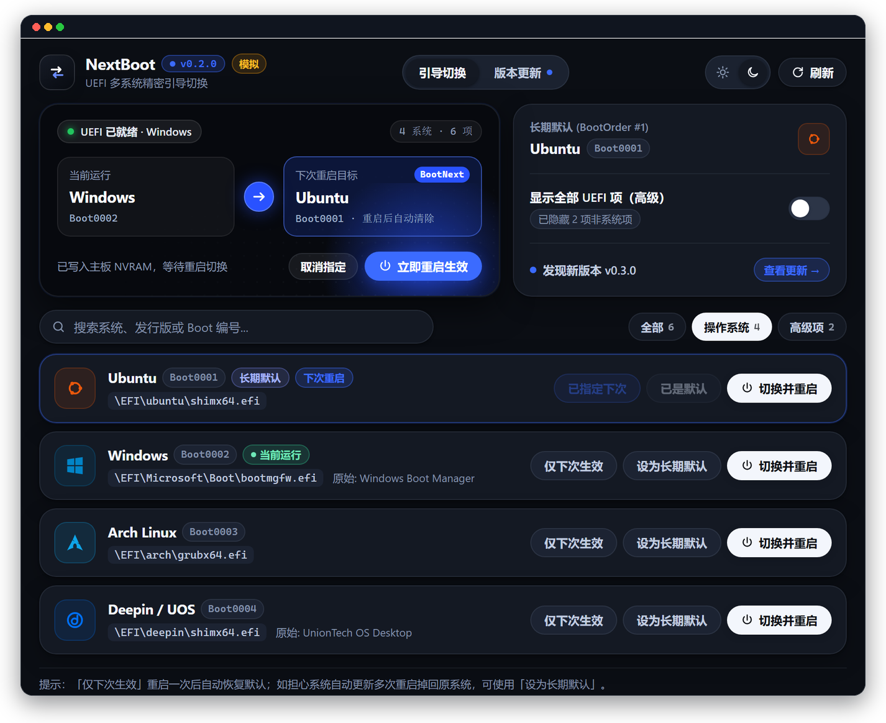
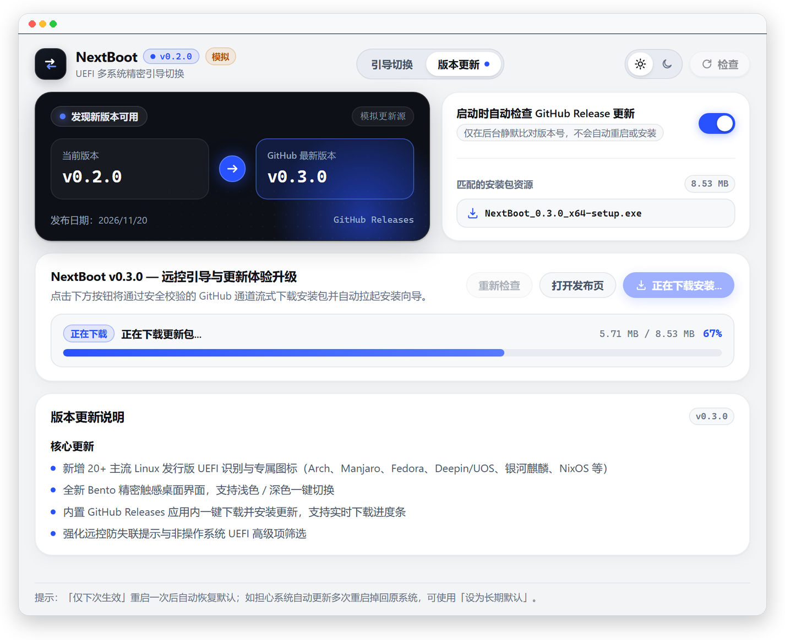
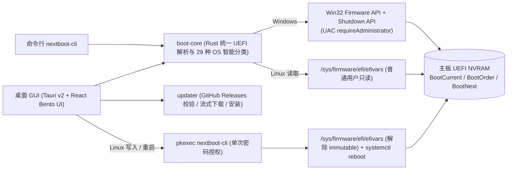

<div align="center">
  

  <br /><br />

  [](https://github.com/zhengbaiyang/nextboot/releases/latest)
  [](https://github.com/zhengbaiyang/nextboot/actions)
  [](#支持-20-主流-linux-发行版识别)
  [](#工作原理与架构)
  [](LICENSE)

  <p>
    <strong>在系统内直接决定下一次重启进入 Windows 或任意 Linux 发行版，告别远控重启失联。</strong>
  </p>

  <p>
    <a href="#界面演示">界面演示</a> ·
    <a href="#v02-核心升级亮点">v0.2 亮点</a> ·
    <a href="#支持-20-主流-linux-发行版识别">发行版支持</a> ·
    <a href="#应用内自动更新">自动更新</a> ·
    <a href="#下载与安装">下载安装</a> ·
    <a href="#命令行cli用法">CLI 用法</a> ·
    <a href="#工作原理与架构">架构原理</a>
  </p>
</div>

---

## 界面演示

### 动态交互预览

> 展示全新 **Bento 精密触感桌面界面** 的完整交互流程：浅色 Bento 总览 → 一键写入 `BootNext`（深邃曜石主卡片实时亮起） → 浅/深色主题一键切换 → 重启二次确认与强制重启开关 → 应用内 GitHub Releases 实时进度更新：

<div align="center">
  
</div>

### 功能界面截图

<table>
  <tr>
    <td align="center" width="50%">
      
      <br />
      <strong>① 浅色 Bento 主界面与曜石状态卡</strong>
      <br />
      <sub>实时展示 <code>当前运行 → 下次重启目标</code>，支持搜索、分类筛选与 29 种系统专属图标</sub>
    </td>
    <td align="center" width="50%">
      
      <br />
      <strong>② 一键切换深色 Obsidian 主题</strong>
      <br />
      <sub>顶栏 Appearance 开关即时切换并持久化，夜间远控维护同样清晰舒适</sub>
    </td>
  </tr>
  <tr>
    <td align="center" width="50%">
      
      <br />
      <strong>③ 精密二次确认与强制重启开关</strong>
      <br />
      <sub>清晰区分「仅下次生效 (BootNext)」与「设为长期默认 (BootOrder)」，内置远控防卡死开关</sub>
    </td>
    <td align="center" width="50%">
      
      <br />
      <strong>④ 应用内 GitHub Releases 自动更新</strong>
      <br />
      <sub>启动静默检测新版本、匹配当前平台安装包、流式下载进度条并一键拉起安装</sub>
    </td>
  </tr>
</table>

---

## v0.2 核心升级亮点

1. **全新 Bento 精密触感桌面界面（Light / Dark 双主题）**
   - 浅色默认 Bento 卡片美学 + 标志性深邃曜石黑 Hero 状态卡片，顶部一键切换浅/深色主题并自动记忆。
   - 内置启动项实时搜索框、快速分类筛选胶囊（`全部` / `操作系统` / `高级项`）与触感 Toggle 开关。
2. **20+ 主流 Linux 发行版 UEFI 识别与专属矢量图标**
   - `boot-core` 分类引擎全面升级至 29 种 `OsKind` 类型与中文/标准 `os_label`，自动从 EFI 路径与启动描述中精准识别常见发行版，CLI 与 GUI 均支持按发行版名称快速检索与切换。
3. **内置 GitHub Releases 应用内自动更新**
   - 自动对接 `github.com/zhengbaiyang/nextboot/releases/latest`，支持启动时静默检查、版本日志预览、白名单域名安全校验、流式实时下载进度条，以及 Windows 安装包自动拉起 / Linux `.deb` `pkexec apt-get install` 一键更新。

---

## 支持 20+ 主流 Linux 发行版识别

`boot-core` 通过 UEFI `EFI_LOAD_OPTION` 路径（如 `\EFI\arch\grubx64.efi`、`\EFI\deepin\shimx64.efi`）与启动项描述自动识别并匹配专属 SVG 图标与系统标签：

| 分类 | 支持识别的系统与发行版 |
| :--- | :--- |
| **主流桌面 / 服务器 Linux** | **Ubuntu** · **Debian** · **Fedora** · **Arch Linux** · **Manjaro** · **Linux Mint** · **Pop!_OS** · **openSUSE** · **Kali Linux** |
| **企业级与红帽系** | **Red Hat (RHEL)** · **Rocky Linux** · **AlmaLinux** · **CentOS** |
| **国产桌面发行版** | **Deepin / UOS (统信)** · **银河麒麟 (Kylin / OpenKylin)** |
| **极客 / 游戏 / 虚拟化发行版** | **NixOS** · **Gentoo** · **EndeavourOS / CachyOS / Garuda** · **Zorin OS** · **elementary OS** · **SteamOS / Bazzite** · **Proxmox VE** · **Alpine Linux** · **Void Linux** |
| **通用引导与其他系统** | **Windows** · **macOS** · 通用 **Linux**（GRUB / systemd-boot / rEFInd / Solus / MX Linux / Nobara / Slackware） |
| **智能隔离的高级风险项** | **网络启动 (PXE / HTTP)** · **USB 设备** · **光驱设备** · **主板固件 / UEFI Shell**（默认隐藏，展开后带醒目风险提醒） |

---

## 应用内自动更新

切换到顶部导航栏的 **「版本更新」**（或点击标题栏版本号徽章）即可完成全流程升级：

- **启动自动检查**：默认开启静默检查（可在「版本更新」面板中通过开关关闭，配置持久化在本地）。
- **安全通道与平台匹配**：仅允许从官方 GitHub Releases 域名下载，并自动匹配当前平台安装包（Windows 优先 `*-setup.exe` / `*.msi`，Linux 优先 `*.deb`）。
- **实时进度与一键安装**：通过 Tauri 事件流实时展示已下载字节数、总大小与百分比进度条；下载完成后 Windows 自动拉起安装向导并退出主程序，Linux 通过 `pkexec apt-get install -y` 提权安装 `.deb`。

---

## 为什么需要 NextBoot？

当你的工作电脑安装了 **Windows + Linux 多系统**，又经常通过 **RustDesk / ToDesk / 向日葵 / RDP / SSH** 远程操作时：

| 常见痛点 | NextBoot 的解决方案 |
| :--- | :--- |
| 远控重启时无法在主板 / GRUB 启动菜单按键选系统 | 在当前系统内直接指定下一次重启进入目标系统（写入 UEFI `BootNext`） |
| 切到 Windows 后，系统更新或意外重启又自动掉回 Linux | 支持一键「**设为长期默认**」（置顶 UEFI `BootOrder`），多次重启仍稳稳进目标系统 |
| 远控点击重启时，Windows 被未保存的记事本/后台程序卡在关机界面 | 重启确认框内置「**强制重启**」开关（Windows 强制关闭阻塞程序 / Linux 忽略 systemd 抑制锁） |
| 跨系统修改对方磁盘分区的 GRUB 配置容易出错甚至损坏文件系统 | 直接读写主板 **UEFI NVRAM**，各系统互不触碰对方磁盘分区，零侵入 |
| 主板 UEFI 列表混杂 PXE 网卡、U 盘、EFI Shell，误点会导致远程失联 | 智能解析 UEFI Device Path，默认仅展示操作系统项，并对非系统项给出醒目警告 |
| 后台常驻服务占资源，或 Linux Wayland 下无法直接用 root 启动 GUI | **按需打开、用完即关**：Windows 嵌入 UAC 清单；Linux GUI 普通用户运行，仅写入/重启时 `pkexec` 单次授权 |

---

## 下载与安装

前往 [**GitHub Releases 页面**](https://github.com/zhengbaiyang/nextboot/releases/latest) 直接下载对应平台安装包（已安装 v0.2+ 后可直接在应用内一键更新）：

| 目标系统 | 推荐下载文件 | 说明 |
| :--- | :--- | :--- |
| **Windows 10 / 11 (桌面版)** | `NextBoot_*_x64-setup.exe` 或 `*.msi` | 正式安装包，打开自动请求一次 UAC 管理员权限 |
| **Windows 10 / 11 (免安装绿色版)** | `NextBoot-portable-windows-x64.exe` | 单文件双击即用，无需安装 |
| **Windows 10 / 11 (命令行版)** | `nextboot-cli.exe` | 适合脚本调用，请在管理员终端运行 |
| **Ubuntu / Debian 系 (桌面+CLI)** | `NextBoot_*_amd64.deb` | 执行 `sudo apt install ./NextBoot_*_amd64.deb`，同时安装桌面图标与 `/usr/bin/nextboot-cli` |
| **Linux (独立命令行版)** | `nextboot-cli-linux-x64` | `chmod +x` 后配合 `sudo` 运行，适用于 Arch / Fedora / Deepin / SSH 等任意 UEFI Linux 环境 |

> **前提要求**：目标电脑需工作在 **UEFI 引导模式**。NextBoot 启动时会自动检测固件环境，若为传统 Legacy BIOS (MBR) 会给出明确提示。

---

## 命令行（CLI）用法

除了桌面图形界面，NextBoot 还内置同源命令行工具 `nextboot-cli`，支持按 `BootXXXX` 编号、启动项描述或发行版标签（`windows` / `ubuntu` / `arch` / `deepin` / `fedora` 等）快速切换：

```bash
# 查看当前运行系统、长期默认与下次指定状态
nextboot-cli status

# 列出启动项（含「系统类型」列，默认过滤 PXE/U盘/固件；加 --all 查看主板全部 UEFI 项）
nextboot-cli list
nextboot-cli list --all

# 设置「仅下一次重启」进入目标系统（支持编号 0003 或关键词 windows / ubuntu / arch / deepin）
sudo nextboot-cli next arch
sudo nextboot-cli next deepin

# 设置下次重启进入 Windows 并立即重启（加 --force 忽略未保存程序/阻止关机锁）
sudo nextboot-cli next windows --reboot
sudo nextboot-cli next windows --reboot --force

# 取消已设置的下次重启指定 (BootNext)，恢复按默认顺序启动
sudo nextboot-cli clear-next

# 将 Windows 设为「长期默认启动项」（置顶 BootOrder，防多次自动重启掉回其他系统）
sudo nextboot-cli default windows
sudo nextboot-cli default windows --reboot

# 安全体验：所有命令均支持 --mock（内置 Ubuntu/Windows/Arch/Deepin/PXE/EFI Shell 模拟数据）与 --json 输出
nextboot-cli --mock status
nextboot-cli --mock list --all
nextboot-cli --mock list --json
```

---

## 工作原理与架构

NextBoot 在 Windows 与 Linux 两端共享同一套纯 Rust 编写的 UEFI `EFI_LOAD_OPTION` 二进制解析与多发行版分类引擎（`boot-core`）：



### 工程目录结构

```text
.
├── crates/
│   ├── boot-core/          # 跨平台 UEFI NVRAM 解析/写入、29 种 OS 智能分类、重启控制、Mock 引擎
│   └── boot-cli/           # 独立命令行工具 nextboot-cli（兼任 Linux GUI 的 pkexec 提权执行器）
├── src-tauri/              # Tauri v2 桌面宿主（UAC 清单、Linux pkexec 桥接、GitHub Releases 自动更新器）
├── src/                    # React + TypeScript + Vite 桌面前端（Bento 浅/深色主题、发行版图标、更新面板）
├── docs/images/            # README 与 Release 展示用 UI 演示动图及高清截图
└── .github/workflows/      # GitHub Actions 双端自动测试、打包与 Release 发布工作流
```

---

## 本地开发与构建

<details>
<summary><strong>点击展开：环境依赖、模拟调试与双端打包命令</strong></summary>

### 1. 环境准备
- **Rust**（1.80+，stable 工具链）
- **Node.js**（20+）与 `npm`
- **Ubuntu 22.04 / 24.04 系统构建依赖**：
  ```bash
  sudo apt-get update
  sudo apt-get install -y libwebkit2gtk-4.1-dev libappindicator3-dev librsvg2-dev patchelf libssl-dev build-essential
  ```

### 2. 单元测试与模拟模式调试（不改动本机 UEFI）
```bash
# 运行核心库、CLI 与桌面更新器单元测试
cargo test -p boot-core -p boot-cli
cargo test -p nextboot

# 模拟模式测试 CLI
cargo run -p boot-cli -- --mock list --all
cargo run -p boot-cli -- --mock next arch
cargo run -p boot-cli -- --mock status

# 安装前端依赖并启动模拟模式桌面开发窗口
npm install
NEXTBOOT_MOCK=1 npm run tauri dev
# Windows PowerShell:
# $env:NEXTBOOT_MOCK="1"; npm run tauri dev
```

### 3. 本地正式打包
```bash
# 1. 先构建 Release 版 CLI（Linux 打 .deb 时会自动将 nextboot-cli 打包到 /usr/bin/nextboot-cli）
cargo build --release -p boot-cli

# 2. 打包桌面端与安装程序（Windows 产出 .exe/.msi，Linux 产出 .deb）
npm run tauri build
```

</details>

<details>
<summary><strong>点击展开：常见问题排查 (FAQ)</strong></summary>

1. **提示当前电脑不是 UEFI 引导模式**
   - Windows 下按 `Win + R` 输入 `msinfo32`，查看「BIOS 模式」是否为 `UEFI`；
   - Linux 下检查 `/sys/firmware/efi/efivars` 目录是否存在。
   - NextBoot 专注 UEFI NVRAM 方案，暂不支持传统 Legacy BIOS (MBR)。
2. **Linux 下源码运行 GUI 点击切换提示找不到 `nextboot-cli`**
   - 通过官方 `.deb` 安装时会自动安装 `/usr/bin/nextboot-cli`；
   - 本地开发调试时请先执行 `cargo build -p boot-cli`，确保 `nextboot-cli` 与主程序位于同一输出目录或已加入 `PATH`。
3. **如何安全验证本机主板是否支持修改 UEFI NVRAM**
   - 在 Linux 下执行 `sudo nextboot-cli next <id>` 后运行 `nextboot-cli status` 查看「下次指定」是否生效，验证完成后执行 `sudo nextboot-cli clear-next` 复原即可。

</details>

---

## License

本项目基于 [MIT License](LICENSE) 开源。
